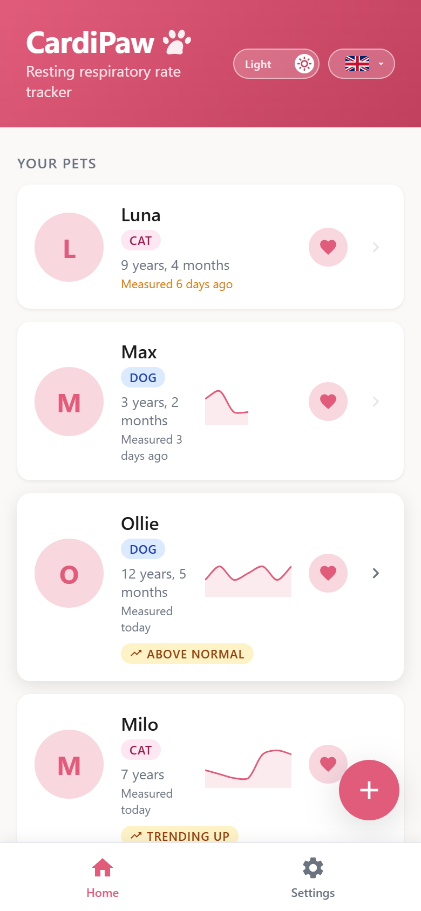
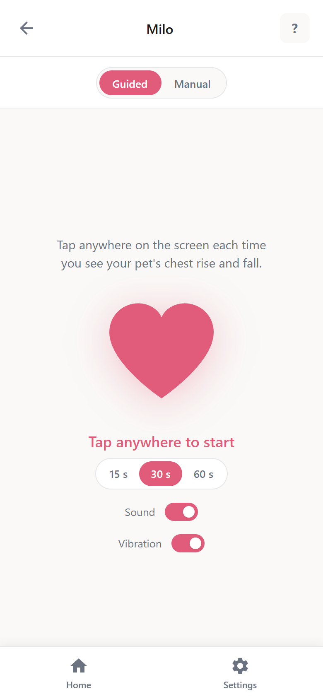
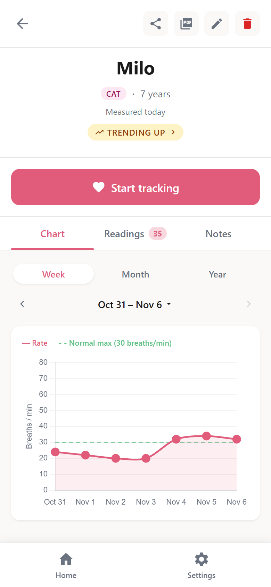
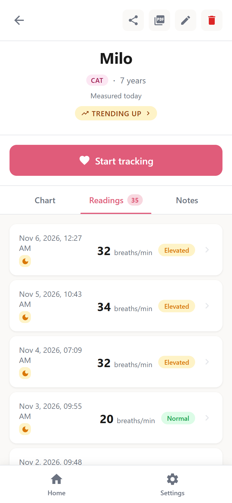

# CardiPaw

[](https://github.com/wesleyegbertsen/CardiPaw/actions/workflows/ci.yml?query=branch%3Amain)
[](https://github.com/wesleyegbertsen/CardiPaw/releases/latest)
[](LICENSE)
[](https://hub.docker.com/r/wesleyegbertsen/cardipaw)

Track your pet's resting respiratory rate (RRR) at home: count breaths with a guided timer, follow the trend over time, and share a clear report with your vet. Free and open source, and your pet data is stored on your device, not on a server.

<p>
  
  
  
  
</p>

## Try It

CardiPaw is available for free at **[cardipaw.com](https://cardipaw.com/)**. No installation required and all data is stored locally in your browser.

It is also available as an [Android app](#android) and as a [Docker image](#docker) you can host yourself.

## Why I Built This

My cat Lushi was diagnosed with HCM (Hypertrophic Cardiomyopathy), a heart condition that requires regular monitoring at home. One of the most important things you can do as an owner of a cat with HCM is to measure their Resting Respiratory Rate (RRR), the number of breaths per minute while they are asleep or at rest. A rising RRR can be an early warning sign of fluid building up around the lungs. Always follow your vet's guidance on what to monitor and when to act.

Tracking this consistently by hand (counting breaths, writing down numbers, trying to spot trends) quickly became tedious and error-prone. I built CardiPaw to make the whole process simple, reliable, and easy to review over time.

## What Is a Resting Respiratory Rate?

The RRR is measured by watching your pet's chest while they are resting or sleeping and counting the number of breaths over a set time (15, 30 or 60 seconds), then converting that count to breaths per minute. Count chest movements: one rise and fall equals one breath. For cats and dogs, a normal RRR is generally **30 breaths/min or fewer**.

## Status Thresholds

| Label    | Rate              |
|----------|-------------------|
| Normal   | ≤ 30 breaths/min  |
| Elevated | 31-35 breaths/min |
| High     | > 35 breaths/min  |

These defaults are based on general veterinary guidance. In a pet's profile you can set its own Normal and Elevated ceilings, and its readings are then labelled against those. Always follow the specific advice of your own vet.

## Features

- **Multiple pets**, each with a name, species, photo and date of birth.
- **Guided tracking**: tap each breath during a 15-, 30- or 60-second count and CardiPaw works out the rate. The screen stays on while you count, where your browser or phone allows it.
- **Camera counting** (experimental, off by default): prop the phone up and CardiPaw suggests a count from your pet's breathing movement, for you to check. The video is analysed on your device and never recorded, stored or sent.
- **Readings** with a timestamp and a Normal, Elevated or High label, plus an optional rest state and note.
- **Charts** by week, month and year, and a 7-day sparkline per pet on the home screen.
- **Trend alerts**: a badge when a pet's resting rate has crept up, or stayed above its Normal ceiling, over the last few days. Not a diagnosis, and no badge doesn't always mean all is well.
- **PDF report** of the months you choose, each with a chart and the full reading list, to hand to your vet.
- **Share links**: a read-only report packed into the link itself. Nothing is uploaded.
- **Pet notes** for medication changes, vet visits and anything else worth keeping.
- **Reminders** to measure, at a time and on the weekdays you choose (Android app).
- **Shortcuts**: long-press the app icon to start measuring one of your pets (Android app).
- **Export and import** of your pets, readings and notes as a JSON file, for backup or moving devices.
- **Languages:** English, Dutch, German, French and Japanese.

Every feature in detail: [docs/features.md](docs/features.md).

## Privacy

Your pets, readings and notes are stored locally on your device and are never sent to any server. A share link carries your pet's name, species and date of birth (and its own Normal and Elevated ceilings, if you set them), along with the readings from the months you pick, inside the link itself (in the URL fragment, which browsers never send to a server), so anyone you send it to can see them. In the Android app, your home screen app shows your pets' names and photos in the app's [shortcuts](docs/android.md#shortcuts). [Camera counting](docs/features.md#camera-counting-experimental) and the Android app's [update check](docs/android.md#updating) are off until you turn them on.

## Android

Every [release](https://github.com/wesleyegbertsen/CardiPaw/releases) includes the Android app as `cardipaw-X.Y.Z.apk`. CardiPaw is not on Google Play yet. Download the APK on your phone, open it, and allow installing unknown apps when Android asks. To update, install a newer APK over the installed app. Don't uninstall it first: uninstalling deletes all of the app's data.

Installing, updating, checking an APK's signing certificate, reminders, shortcuts and permissions: [docs/android.md](docs/android.md).

## Docker

The app is available as a pre-built image on Docker Hub: [wesleyegbertsen/cardipaw](https://hub.docker.com/r/wesleyegbertsen/cardipaw)

```bash
docker run -d -p 8080:80 --name cardipaw wesleyegbertsen/cardipaw:latest
```

Then open `http://localhost:8080`. For docker-compose and pinning a version, see [docs/self-hosting.md](docs/self-hosting.md).

## Contributing a Translation

To fix a label or add a language, see [docs/translations.md](docs/translations.md).

## Contributing

For development setup, tests, PR titles and the Android build, see [CONTRIBUTING.md](CONTRIBUTING.md). How releases are versioned and published is in [docs/releasing.md](docs/releasing.md).

## Tech Stack

- [Vue 3](https://vuejs.org/) + TypeScript
- [Pinia](https://pinia.vuejs.org/) for state management
- [Chart.js](https://www.chartjs.org/) + [vue-chartjs](https://vue-chartjs.org/) for visualisations
- [IndexedDB](https://developer.mozilla.org/en-US/docs/Web/API/IndexedDB_API) (via [idb](https://github.com/jakearchibald/idb)) for local persistence
- [Vite](https://vitejs.dev/) as the build tool
- [Capacitor](https://capacitorjs.com/) for the Android app

## License

CardiPaw is licensed under the [GNU General Public License v3.0](LICENSE).
